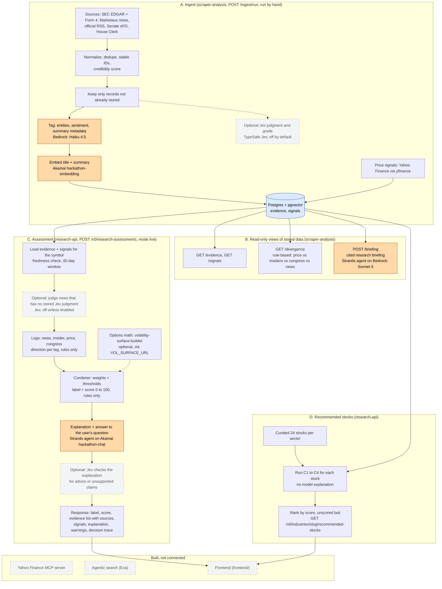
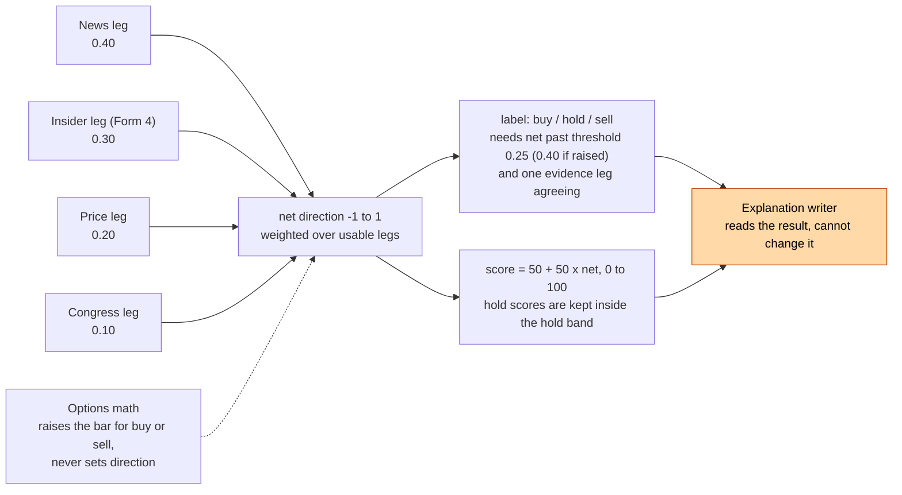

# Pipelines and where AI is used

State as of 2026-10-11. GitHub renders the diagrams below. **Orange boxes are AI calls; everything else is plain code or math.** Dashed boxes are built but not connected to anything yet.

The rule that matters most: **the label (`buy` / `hold` / `sell`) and the 0 to 100 score are never produced by a model.** They come from a fixed rule (`combiner-v1`). Models write summaries, tags and explanations around that result.

## 1. End to end

## 2. Every AI touchpoint

| # | Step | Model and provider | Input | Output | Can change the label or score? | On by default |
|---|---|---|---|---|---|---|
| 1 | Tag each new record at ingest | Haiku 4.5, Bedrock (`BEDROCK_TAGGING_MODEL_ID`) | Title and summary | Entities, sentiment, summary metadata | **No.** Tags are stored and shown, but the news leg does not read them (it reads only Jev judgments, rows 3 and 5) | Yes (`tag=true`) |
| 2 | Embed each new record | `hackathon-embedding`, Akamai (1024 dimensions) | Title and summary | Vector in pgvector | No | Yes, if Akamai env is set |
| 3 | Jev judgment and grade at ingest | TypeSafe Jev (`JEV_ENABLED`) | News and social text | `details.jev`, `details.grade`, off-topic flags | Yes, indirectly: the news leg reads only these judgments | **No** |
| 4 | Research briefing | Sonnet 5, Bedrock, Strands agent with lookup tools (`BEDROCK_SYNTHESIS_MODEL_ID`) | Stored evidence and signals | Cited points, conflicts, data gaps, uncertainty | No. It never gives buy or sell | On request (`POST /briefing`) |
| 5 | Judge unjudged news at assessment time | TypeSafe Jev | Article title and summary | Direction and relevance | Yes, indirectly: this is the news leg's only input if no judgment was stored at ingest | **No** |
| 6 | Embed the user's question | `hackathon-embedding`, Akamai | The `query` text | Vector for semantic search of stored evidence | No. It only picks which records the explanation looks at first | Only if a `query` is sent |
| 7 | Write the explanation and answer | `hackathon-chat`, Akamai, Strands agent | Evidence, signals, the decision result | Explanation points with evidence IDs, answer | **No.** The label and score are fixed before this step | Yes in `live`; falls back to a template if inference is not configured |
| 8 | Review the explanation | TypeSafe Jev | The written explanation and its evidence | Flags advice or unsupported claims; a failed review replaces the text with a template | No | **No** |

Everything not in this table is deterministic: source fetching, dedupe, credibility, signals, divergence, the legs, the combiner, the score, the freshness check, ranking, and the options math.

## 3. What decides the label and score

- At least two legs must be usable, or the result is `insufficient_data` with no score.
- A price move alone can never carry a buy or sell: one evidence leg (news, insider or congress) has to point the same way, otherwise the label is held at `hold`.
- The weights and thresholds are hand-set, not fitted to data. The score is a position on that scale, not a probability.

## 4. Known gaps in the pipeline

- **The news leg is empty while Jev is off.** It uses only records with a Jev judgment, and the Bedrock tags are not read by the combiner. With `JEV_ENABLED` unset (today), no news is judged, so a symbol's result rests on insiders, price and congress alone. Symbols with fewer than two usable legs return `insufficient_data` (AAPL did, despite 34 stored rows). Turning Jev on, or feeding the tags into the news leg, is the main lever for more scored stocks.
- **Ingest is manual.** Nothing runs on a schedule (the scheduler is off), and `live` assessments never trigger ingestion. Stored evidence goes stale; the freshness window is set to 7 days for now.
- **Coverage.** As of this writing about 25 symbols have stored evidence, so most of each sector is unscored.
- **Optional Jev steps are off**, so rows 3, 5 and 8 above do not run today.
- **Bedrock access.** The 5.5 models are refused by the account, so tagging uses Haiku 4.5 and the briefing uses Sonnet 5. See `BEDROCK_MODELS_WORKING` in `scraper-analysis/src/scraper_analysis/config.py`.
- **Not connected:** the Yahoo Finance MCP server, agentic search (Exa) and the frontend call nothing in this pipeline yet.
- **Option math** needs `VOL_SURFACE_URL`; a live option chain has not been run through it end to end.
