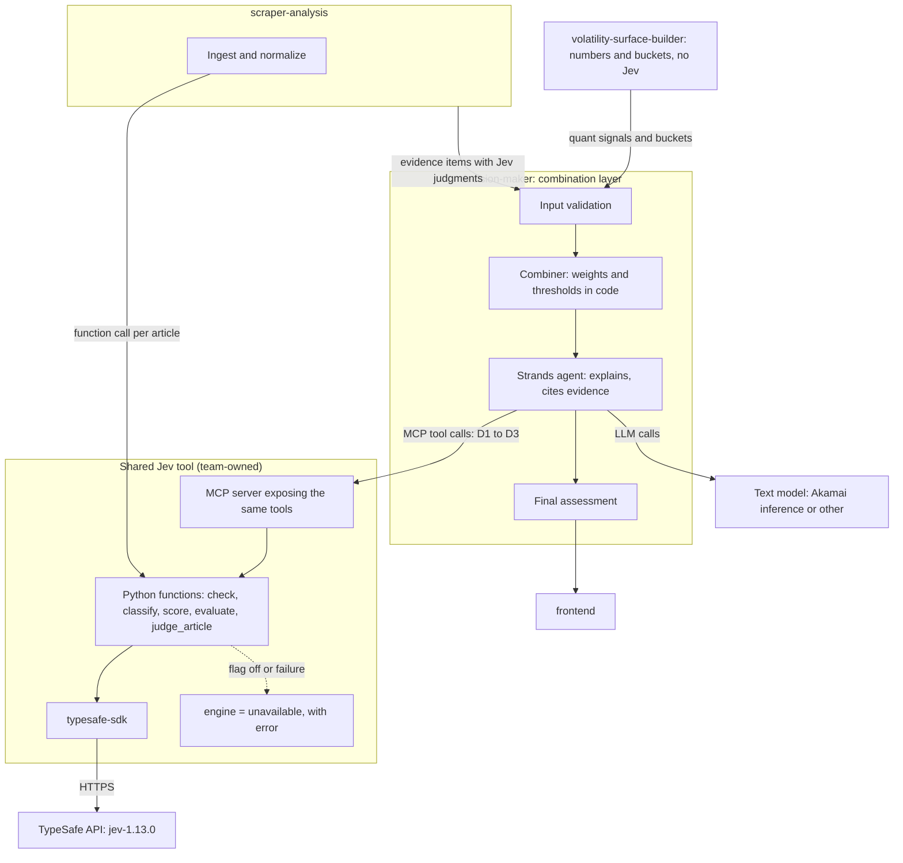
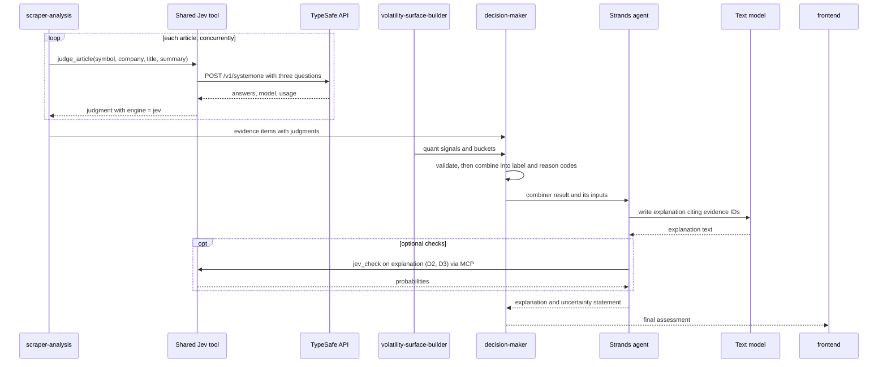
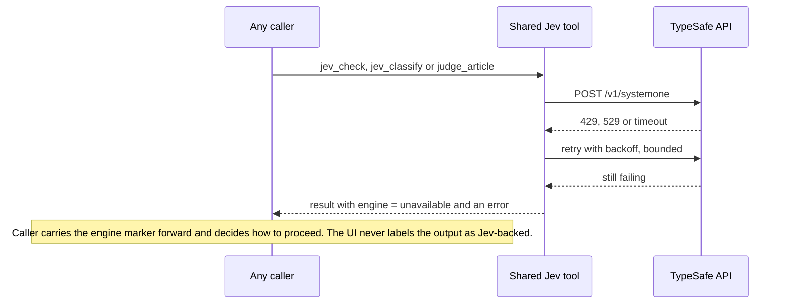

# Jev integration research

> Repository-status update (2026-10-10): the volatility-surface project is now implemented locally under [`microservices/volatility-surface-builder`](../microservices/volatility-surface-builder/README.md). The dated scaffold description in §2 is historical; the Jev usage guidance remains that numeric options calculations stay in code.

> **Status:** Research reference, not a decision record and not an implementation. Nothing here has been called, installed or provisioned. Recommendations are proposals for the team; confirmed choices belong in [DECISIONS.md](DECISIONS.md).
>
> **Research date:** 2026-10-10 · **Versions observed:** model `jev-1.13.0` (aliases `jev-latest`, `jev-preview`), Python SDK `typesafe-sdk` 0.7.3 (released 2026-10-09), HTTP API `v1`.
>
> **Implementation status (2026-10-10):** the shared Jev tool described in §7 now exists at [`microservices/jev-tool`](../microservices/jev-tool/README.md), built against `typesafe-sdk` 0.7.4, `mcp` 2.1.1 and `strands-agents` 1.59.0. It passes offline tests (real SDK client against a mock HTTP transport, plus a real stdio MCP round trip through Strands' `MCPClient`). **Real calls have since been made** (direct and through MCP); see "Observed results" in §12.
>
> **Evidence labels used throughout**
>
> | Label | Meaning |
> |---|---|
> | **[Official]** | Read from TypeSafe's own site, docs or GitHub org on the research date |
> | **[Third-party]** | From a blog, directory or integration vendor; not confirmed by TypeSafe |
> | **[Vendor claim]** | Stated by TypeSafe about its own product; not independently verified |
> | **[Unverified]** | Could not be confirmed; must be checked before relying on it |
> | **[Recommendation]** | This document's proposal; not a team decision |

## 1. Executive summary

- **Jev is not an LLM.** It is TypeSafe AI's "System One" decision model: you send one `state` plus a set of typed questions, and it returns typed answers with probability distributions. It cannot generate text, run an agent loop, or call tools. **[Official]**
- **It fits the role the team sketched** ("quick, low-cost categorical decisions, yes/no answers, and scoring" in [DUMP.md](DUMP.md)) well. Its three question types are exactly yes/no (`noul`), categorical (`choice`) and ordinal (`score`).
- **Two findings contradict assumptions in our docs:**
  1. **TypeSafe publishes no official MCP server.** Only community servers exist. "JEV via MCP" therefore means we either trust community code or write a small server ourselves.
  2. **Access is not confirmed.** Jev is in early access; one third-party source reports direct signups were paused in late September 2026. Gateways (OpenRouter, Vercel AI Gateway, Cloudflare Workers AI) list Jev, but calling them from Python is unverified.
- **Jev is documented as weak at arithmetic, dates and ordering,** and its Score magnitudes are "weakly calibrated". It should judge text evidence, not do quant work or produce a numeric prediction.
- **Direction (set by Jet, 2026-10-10):** Jev is a **shared, project-wide tool** for quick, cheap decisions that would otherwise cost an LLM agent turn. `decision-maker` is the **combination layer** where article information and math come in and the final output decision is made. §6 lists where Jev should and should not be used.
- **Recommended shape [Recommendation]:** one team-owned Jev tool wrapping the official Python SDK, usable two ways: as Python functions for pipeline code and as an MCP server for Strands agents. It carries the retries, pinned model and feature flag once, for every caller, and marks every result with whether Jev actually answered. Inside `decision-maker`, code combines the judged articles with the quant signals using documented weights to produce `buy` / `hold` / `sell` / `insufficient_data`, and an agent explains the result.
- **First step is access, not code.** Until someone observes one real call, the Gate 0 question in `DECISIONS.md` stays open and the sponsor-style claim cannot be made.

## 2. Relevant project context

Taken from the existing docs; none of this is changed by this document.

| Area | What the docs say | Source |
|---|---|---|
| Product | Evidence-backed stock research aid with an explainable buy/hold/sell assessment, horizon and uncertainty. Not trading, not advice. | [README.md](README.md), [PROJECT_BRIEF.md](PROJECT_BRIEF.md) |
| Stack (proposed) | Python backend orchestrated with Strands Agents SDK; Next.js/TypeScript frontend; Akamai Cloud hosting and hosted inference | [DECISIONS.md](DECISIONS.md) |
| Jev's intended role | "A narrow classification/decision step through MCP"; decision agent "will receive the math agent's results and return a categorical decision" | [README.md](README.md), [DUMP.md](DUMP.md) |
| Ownership | Jet owns Strands flow, the decision/MCP adapter and Jev (lane A; tasks A1–A3) | [AGENTS.md](AGENTS.md), [TASKS.md](TASKS.md) |
| Contract | Assessment has `label` (`buy`/`hold`/`sell`/`insufficient_data`), `horizon`, `reason_codes` or evidence IDs, explanation, `generated_at`, `data_mode`, uncertainty statement; numeric score optional and must have a documented meaning | [ARCHITECTURE.md](ARCHITECTURE.md) |
| Guardrails | A 0–100 score is a labelled heuristic, not a probability. No accuracy claims without time-split evaluation. All external services behind adapters with offline fixtures. Don't silently swap an integration for a mock. Jev claims need an observed call. | [PROJECT_BRIEF.md](PROJECT_BRIEF.md), [AGENTS.md](AGENTS.md) |
| Open (Gate 0) | "Is JEV accessible and callable through MCP; what is its input/output contract?" Owner: Jet. Evidence needed: observed test call, policy, latency. | [DECISIONS.md](DECISIONS.md) |

**Repository layout (added 2026-10-10, after the microservice scaffold landed).** The repo now has `frontend/` and `microservices/` with three services: `decision-maker`, `scraper-analysis` and `volatility-surface-builder`. All are empty scaffolds; `microservices/microservices.md` is a heading only. `microservices/decision-maker` (Jet) is the combination layer that makes the final decision; the Jev connection is a shared tool used across services (see §6 and §7). Mapping of the other two folders to lanes is inferred from their names (`scraper-analysis` → Cai's sources and analysis; `volatility-surface-builder` → Hemanth's baseline) and is not yet documented by the team. The older docs still describe a single Python backend; sections 7, 8 and 13 below follow the microservice layout.

**A1 contract proposal (added 2026-10-10).** Branch `jet/a1-api-contract` adds `docs/api-contract-v0.md`: a proposed `POST /v0/research-assessments` route with evidence, signals, assessment, warnings and an error envelope. It is pending Gate 0 review and says A2 must not start before then. It keeps `microservices/jev-tool` as the shared Jev wrapper, gated by `JEV_ENABLED`, with `engine: unavailable` propagating openly, which matches the tool as built. §7 lists how this document lines up with it and three gaps to raise at Gate 0.

**Undecided things that affect a Jev integration** (not resolved here): the v0 API schema, the demo symbol set, the news source and what excerpt length we may store or send onward, which LLM/inference backend drives Strands, the assessment horizon, and whether a vector DB exists at all.

**Where Jev could add value in this project:** see the full list in §6.

## 3. Jev technical overview

**Who and what.** TypeSafe AI describes itself as building "machine-native intelligence infrastructure for automation". Jev is its first public model and the first "System One" model, launched into early access around 14 September 2026. **[Official]** ([typesafe.ai](https://typesafe.ai), [launch post](https://typesafe.ai/blog/introducing-system-one-models-and-jev); launch date from **[Third-party]** sources)

**Conceptual model.** **[Official]** ([Introduction](https://docs.typesafe.ai/introduction), [State](https://docs.typesafe.ai/concepts/state.md), [How to build](https://docs.typesafe.ai/concepts/how-to-build-with-system-one))

- A request holds one **state** (string, JSON object, or array; text only) and a map of **questions**.
- Every question is evaluated **in parallel and in isolation** against the same state. Adding questions "barely changes response time".
- Answers are constrained to the options you supplied. There is no free text to parse.
- The intended design is: code keeps control flow, rules and side effects; the model supplies narrow judgments over unstructured data; code combines them.

**The three primitives.** **[Official]** ([Primitives](https://docs.typesafe.ai/primitives), [API reference](https://docs.typesafe.ai/api), [Score](https://docs.typesafe.ai/primitives/score.md))

| Type | Question fields | Answer fields | Notes |
|---|---|---|---|
| `noul` | `instructions`; optional `criteria` with `true` / `false` descriptions | `noul` (0–1) | Probability the statement is true. No `confidence` field. |
| `choice` | `instructions`; `criteria` = map of option → description or null | `choice`, `probabilities`, `confidence` | Max 255 options |
| `score` | `instructions`; `criteria` = ordered array, low → high | `score`, `probabilities`, `confidence`, `legend` | 2–10 levels. `score` is the probability-weighted mean of level indexes starting at 0. Docs suggest three levels as typical. |

**Confidence.** A 0–1 summary of how peaked the probability distribution is; 1 means all mass on one outcome, 0 means evenly spread. For a Noul the docs suggest `|2p − 1|` if you want an equivalent. The docs give no universal thresholds and say to tune on your own data. **[Official]** ([Confidence](https://docs.typesafe.ai/confidence))

> **Caution.** The launch post says Jev is "calibrated: higher confidence means higher accuracy". **[Vendor claim]** The Confidence docs page makes no calibration claim and notes that confidence "describes the model's answer, not whether that answer is correct". Treat calibration as unproven for financial news.

**How it differs from an LLM API**

| | LLM chat/completions API | Jev System One API |
|---|---|---|
| Output | Free text or JSON you must validate | Typed values from options you defined |
| Uncertainty | Self-reported, if asked | Probability distribution on every answer |
| Text generation | Yes | **No** |
| Tool calling / agent loop | Yes | **No** |
| Latency | Seconds | 70–500 ms end to end **[Vendor claim]** |
| Price | Input and output tokens billed | $0.042 per million input tokens; output free **[Official]** |
| OpenAI-compatible | Usually | **No.** Own endpoint and schema |

## 4. Relevant Jev capabilities and limitations

### Capabilities that match our needs

| Need in our project | Jev feature | Fit |
|---|---|---|
| Categorical read of a news item | `choice` with probabilities | Strong |
| Yes/no relevance or "mentions X" checks | `noul` | Strong |
| Ordinal materiality / strength rating | `score` (3 levels) | Good, as a coarse rating only |
| Many judgments on one item at once | Parallel questions in one request | Strong |
| "Uncertainty" field in our Assessment | `confidence` and raw `probabilities` | Useful input; must be described honestly (see §10) |
| Traceable reasons | Per-question answers keyed by our own IDs | Strong; maps onto `reason_codes` |
| Low latency and cost in a demo | Sub-second, fractions of a cent | Strong **[Vendor claim]** on latency |

### Limits

**[Official]** ([Models](https://docs.typesafe.ai/models))

| Item | Value |
|---|---|
| Context per request | 64k tokens, `state` plus all questions combined |
| Context per single question | 32k tokens for `state` plus the longest question |
| Max questions | Not specified; bounded by the 64k budget |
| Input modality | Text only. English is the primary training language. |
| Rate limits | 100K tokens/sec and 80 requests/sec; "adjusting dynamically", may change without notice |
| Choice options | ≤ 255 |
| Score levels | 2–10 |

### Known weaknesses of `jev-1.13`

**[Official]** ([Jev 1.13 jaggedness](https://docs.typesafe.ai/model-jaggedness/jev-1.13.md)). Each one has a direct consequence for a finance app.

| Weakness | Consequence for us |
|---|---|
| "Jev is not a calculator." Counting and numeric comparison are unreliable. | Never ask Jev to compare prices, returns, volatility or ratios. Compute in code and pass named buckets (for example `"trend_30d": "down"`). |
| Dates are read as text; ordering, duration and window checks are unreliable. | Staleness, recency and horizon logic stay in code. Don't ask "is this article recent?". |
| Score levels are weakly calibrated; don't reconstruct magnitudes from them. | A Jev score must not be shown as a 0–100 probability. Use it for threshold checks and ranking only. |
| Accuracy drops as state fills with unrelated content ("context rot"). | Send one article (or one small bundle) per request, not the whole evidence set. |
| State is not treated as hostile; injected instructions can shift answers. | Scraped news and pasted user text are untrusted. Don't make Jev the sole safeguard. |
| Reads questions literally; weak on negation and multi-hop. | Write direct, single-property questions with explicit boundary cases. |
| Leans toward the first Choice option. | Check stability by reordering options during the proof of concept. |
| Cannot generate text. | The explanation shown to the user needs an LLM or templates. |

### Things Jev does not do at all

Write the explanation; act as the model behind a Strands `Agent`; fetch data; remember anything between requests; process charts or images.

## 5. Official API and SDK documentation

### Endpoints

**[Official]** ([API reference](https://docs.typesafe.ai/api), [Models](https://docs.typesafe.ai/models))

| Purpose | Request |
|---|---|
| Evaluate | `POST https://api.typesafe.ai/v1/systemone` |
| List models | `GET https://api.typesafe.ai/v1/models` (returns aliases; versioned IDs are accepted though not listed) |

Headers: `Authorization: Bearer <API_KEY>`, `Content-Type: application/json`.

### Request body

| Field | Type | Required | Notes |
|---|---|---|---|
| `state` | string \| object \| array | yes | Content to evaluate |
| `model` | string | yes | `jev-latest`, `jev-preview`, or a pinned ID such as `jev-1.13.0` |
| `questions` | map of id → Question | yes | IDs are ours; they are not sent to the model and answers return under the same IDs |

Each Question has `type` (`noul` \| `choice` \| `score`) and `instructions` (string, object or array), plus `criteria` as described in §3.

### Response body

| Field | Type | Notes |
|---|---|---|
| `model` | string | The versioned ID that actually answered. Log it. |
| `answers` | map of id → Answer | Each has `type` and the fields in §3 |
| `usage` | object | `input_tokens`, `output_tokens` |

### Errors

| Status | Meaning | Handling |
|---|---|---|
| 401 | Missing or invalid key | Fail fast; do not retry |
| 422 | Validation failed; body names the field | Bug on our side; do not retry |
| 429 | Rate limited | Exponential backoff; SDK honours `retry-after` |
| 529 | Service overloaded | Exponential backoff |

### Models and versioning

- `jev-latest` → latest stable; `jev-preview` → latest of any kind. Both currently resolve to `jev-1.13.0`.
- Aliases move without notice, so answers can change with no change on our side. **Pin `jev-1.13.0`** once thresholds are tuned.
- No formal deprecation policy is published.

### Authentication and keys

- Keys are created at [console.typesafe.ai/keys](https://console.typesafe.ai/keys). **[Official]**
- Early access is waitlist-gated. **[Official]** Direct signups reportedly paused in late September 2026. **[Third-party]** ([flaviocopes.com](https://flaviocopes.com/jev-vercel-ai-sdk.md))

### SDKs

| SDK | Package | Status | Source |
|---|---|---|---|
| Python | `typesafe-sdk` (PyPI), Python ≥ 3.10, MIT. Latest 0.7.3 (2026-10-09). | **[Official]** | [repo](https://github.com/typesafe-ai/typesafe-sdk-python), [docs](https://docs.typesafe.ai/sdk/python), [changelog](https://docs.typesafe.ai/sdk/python/changelog.md) |
| JavaScript/TypeScript | `@typesafe-ai/sdk` | **[Official]** repo; package name from a **[Third-party]** article | [repo](https://github.com/typesafe-ai/typesafe-sdk-js) |
| LLM-backed drop-in | `system-one-adapter` (same `system_one` interface, backed by OpenAI/Anthropic/Gemini or OpenAI-compatible endpoints) | **[Official]** | [repo](https://github.com/typesafe-ai/system-one-adapter-python) |

**Python SDK facts** ([Usage](https://docs.typesafe.ai/sdk/python/usage.md), [Exceptions](https://docs.typesafe.ai/sdk/python/api/exceptions.md)) **[Official]**

- Clients: `TypeSafeClient` (sync) and `AsyncTypeSafeClient` (async), both context managers. Constructor accepts `api_key`, `base_url`, `model`, `http_client`, `retry`.
- Environment variables: `TYPESAFE_API_KEY` (required), `TYPESAFE_BASE_URL` (default `https://api.typesafe.ai`), `TYPESAFE_DEFAULT_MODEL` (default `jev-latest`), `TYPESAFE_LOG_LEVEL`.
- Question classes: `Noul`, `Choice`, `Score`. Raw dicts are also accepted.
- `RetryPolicy` can be set on the client or per call. Defaults read from the installed 0.7.4 package: `max_retries=2`, `backoff_initial=0.5`, `backoff_max=5.0`, `backoff_jitter=0.25`, `respect_retry_after=True`, overall `timeout=30.0`; the client's default per-operation HTTP timeout is 10 s.
- Results expose `request_id` and `raw_http_response`.
- Exceptions: `TypeSafeError` → `TypeSafeAPIError` (`status`, `body`, `headers`, `endpoint`, `request_id`) with subclasses for 400/401/403/404/422/429/5xx and `TypeSafeAPIResponseValidationError`; `TypeSafeAPIConnectionError` → `TypeSafeAPITimeoutError`. `TypeSafeRateLimitError` carries `retry_after_ms`.
- Reuse one client; each new client pays a TLS handshake.
- **Debug logging does not redact request or response bodies.** Keep `TYPESAFE_LOG_LEVEL` at `info` or lower in any shared environment.
- **Breaking changes are recent:** 0.6.0 (2026-09-15) changed `Score.criteria` to an ordered sequence; 0.7.0 (2026-09-18) switched serialization to pydantic. Pin an exact version.

### Other access routes

| Route | Identifier | Status |
|---|---|---|
| OpenRouter | `typesafe/jev-1.13`, `~typesafe/jev-latest`, `typesafe/jev-router` | Listed **[Third-party]** ([openrouter.ai/typesafe](https://openrouter.ai/typesafe)). Request shape and pricing **[Unverified]**. |
| Vercel AI Gateway | `typesafe-ai/jev`; TypeSafe-compatible base URL `https://ai-gateway.vercel.sh/typesafe`; optional zero-data-retention flag on paid plans | **[Third-party]** ([flaviocopes.com](https://flaviocopes.com/jev-vercel-ai-sdk.md)). If accurate, the Python SDK could point at it via `base_url`; **[Unverified]**. |
| Cloudflare Workers AI | `typesafe/jev` | Listed **[Third-party]**; not investigated |
| Composio toolkit | Tools `JEV_EVALUATE_STATE`, `JEV_LIST_MODELS`; can expose a hosted MCP URL; needs our own Jev key | **[Third-party]** ([composio.dev](https://composio.dev/toolkits/jev.md)) |

### MCP

- **There is no official TypeSafe MCP server.** **[Third-party]** statement ([mcpplaygroundonline.com](https://mcpplaygroundonline.com/blog/jev-mcp.md)), consistent with the official docs index ([llms.txt](https://docs.typesafe.ai/llms.txt)), which lists an "Agent skill" page and no MCP page.
- Community servers exist (several named `jev-mcp`, plus `typesafe-mcp`, `system1-mcp`, `use-jev`). They use stdio, need our own key, and expose tools such as `jev_classify`, `jev_score`, `jev_check`. None was audited. ([resource list](https://www.scriptbyai.com/jev-resource-list/))
- The official **agent skill** ([docs](https://docs.typesafe.ai/agent-skill.md), [repo](https://github.com/typesafe-ai/skills)) teaches a coding agent how to write Jev code. It is not a runtime integration.

## 6. Where Jev should be used across the project

> **Direction set by Jet on 2026-10-10.** Jev is a **shared, project-wide utility** for quick, cheap decisions that would otherwise be delegated to an LLM agent. `decision-maker` is the **combination layer**: article information and math come in, and the final output decision is made there. This replaces the earlier framing in which Jev lived only inside `decision-maker`. The specific placements below are **[Recommendation]** and have not been reviewed by the other lane owners.

**The rule of thumb.** Reach for Jev when the answer is a yes/no, a pick from a fixed list, or a coarse rating, and the input is text. Use code when the input is numbers or dates. Use an LLM when the output has to be written text or when the task needs several reasoning steps.

### Recommended uses, by area

Priority: **MVP** = part of the first vertical slice; **Next** = worthwhile once the slice works; **Deferred** = depends on a feature the brief defers.

#### `scraper-analysis` (news collection and tagging)

| # | Quick decision | Type | Jev receives | Caller does with the answer | Priority |
|---|---|---|---|---|---|
| S1 | Is this article mainly about the target company? | noul | Title, permitted summary, company name and ticker | Drops or down-weights off-topic items | MVP |
| S2 | What does the article report about the company's outlook? | choice: negative / neutral / positive / mixed | Same | Attaches `direction` and its probabilities to the evidence item | MVP |
| S3 | How significant is the reported event? | score: routine or promotional / notable / major | Same | Attaches `materiality` | MVP |
| S4 | Which topic tags apply? (DUMP: "the agent may add additional tags") | one noul per candidate tag, or a choice for a single primary category | Title and summary; tag list with one-line descriptions | Stores tags for search and display | Next |
| S5 | Is this usable content, or a paywall stub, error page, ad or empty scrape? | noul | Title and summary | Flags junk; the caller decides whether to discard. **Built** into `judge_article` as `usable_content` (`article-v4`), alongside `sensational`. | Next |
| S6 | Do these two items describe the same story? | noul per candidate pair | Titles and summaries | Marks duplicates across outlets. Generate candidate pairs in code first so the pair count stays small. **Built** as `same_story` (`same-story-v1`). | Next |
| S7 | What kind of content is this: company announcement, news report, opinion or analysis, social media post, other? | choice | Title and summary | Lets the combiner weigh a company's own promotion or a single social post less than independent reporting. **Built** into `judge_article` as `content_type` (question set `article-v2`). | MVP |
| S8 | What kind of event is this: earnings or guidance, legal or regulatory, product or service, deal or partnership, management or workforce, operations or supply, market or macro, stock or valuation view, other? | choice | Title and summary | Lets `decision-maker` connect news to what the options market is pricing (see the quant section below). **Built** into `judge_article` as `event_type` (`article-v3`). | MVP |
| S9 | Does the article describe an upcoming scheduled event (for example an earnings date, a ruling, a launch)? | noul | Title and summary | Flags a known catalyst ahead; code widens the uncertainty statement. Jev only spots the mention; any date maths stays in code. **Built** as `upcoming_event` (`article-v3`). | MVP |

S1–S3 fit in **one request per article** as three parallel questions. S4, S5 and S7 can ride in the same request at almost no extra latency (the "speculative fan-out" pattern in the official docs).

#### `volatility-surface-builder` (quant)

**What the starting code is.** [hemanthsrp/vol-surface-builder](https://github.com/hemanthsrp/vol-surface-builder) was read on 2026-10-10 (README, `main.py`, `src/data_feed.py`, `src/surface_builder.py`, `src/svi_calibration.py`, `docs/methodology.md`).

- It is numeric from end to end: it pulls option chains from yfinance (or generates synthetic ones), inverts Black-Scholes to implied volatility, interpolates a surface and draws charts.
- It contains **no news scraping, no text handling, no prediction and no buy/sell/hold output.**
- Its product-facing numbers come from `compute_surface_statistics(df, S)`: `atm_iv_mean`, `skew_25d_proxy`, IV / strike / maturity ranges, point and expiry counts. `calibrate_svi_surface(df)` adds a per-expiry `rmse` and `converged` flag.
- Per its own methodology note, these describe **how much movement and downside protection the options market is pricing**. They do not say which way the stock will go.

**No Jev use inside this service.** Jev "is not a calculator" and is unreliable at comparing numbers and ordering dates. Jev improves the decision at the seams around it:

| Seam | Who does it | What it adds to the decision |
|---|---|---|
| News judgment (S1–S3) | Jev, via `judge_article` | The direction that the volatility numbers cannot supply |
| Linking news to volatility (S8, S9) | Jev classifies event type and spots upcoming scheduled events | Code can explain a volatility reading ("short-dated implied volatility is high and there is an upcoming-earnings article") instead of leaving it unexplained |
| Numbers into words | **Code in this service, not Jev** | Named buckets that `decision-maker` and any Jev cross-check can consume |
| Final cross-check (D1) | Jev, over a short text summary of news counts and volatility buckets | Disagreement with the code's label lowers stated certainty or yields `insufficient_data` |

**Proposed buckets [Recommendation for this service's owner; not agreed].**

| Bucket | Derived from | Values |
|---|---|---|
| Skew | `skew_25d_proxy` | `normal` / `steep` |
| Term structure | ATM implied volatility at short vs long maturities | `normal` / `flat` / `inverted` |
| Data quality | point count, expiry count, SVI `converged` | `ok` / `thin` |

Cautions:

- **"Elevated" needs history.** One snapshot's `atm_iv_mean` cannot be called high or low without a baseline for that symbol, which the code does not keep.
- **Volatility informs uncertainty and horizon, not direction.** Using it to push the label toward buy or sell would be an unsupported claim.
- **SPY is the code's default ticker** and is an ETF; company-style news questions fit it poorly. Demo symbols should be single companies if news judgment is part of the demo.

#### `decision-maker` (combination layer; final decision)

| # | Quick decision | Type | Jev receives | Caller does with the answer | Priority |
|---|---|---|---|---|---|
| D1 | Cross-check of the final label | choice: buy / hold / sell / insufficient_data | A small text summary: counts by direction and materiality, named quant buckets. No raw numbers. | Compared with the combiner's label; disagreement lowers stated certainty or yields `insufficient_data`. Not the source of truth. | Next |
| D2 | Is each sentence of the written explanation supported by the evidence it cites? | noul per sentence | The sentences plus the evidence items | Removes or flags unsupported sentences. **Built** as `check_explanation` (`explanation-v1`). | Next |
| D3 | Does the explanation promise returns, state certainty, or read as personal advice? | noul per rule | The explanation text | Blocks or rewrites before it reaches the UI. Supports the project's "not advice" guardrail. **Built** in the same `check_explanation` call. | Next |

How the final label itself is produced inside `decision-maker` is covered in §7.

#### Agent orchestration (anywhere a Strands agent runs)

| # | Quick decision | Type | Replaces | Priority |
|---|---|---|---|---|
| O1 | Which handler, tool or sub-agent should take this request? | choice | An LLM "router" turn | Next |
| O2 | Is the collected evidence enough to proceed, or should more be fetched? | noul | An LLM "reflect" turn. Keep any count-based part of this in code. | Next |
| O3 | Screen text going into or out of an LLM for obvious problems | noul per hazard | A separate LLM guardrail call | Deferred |

O3 comes with a caveat: Jev's own docs say it is not hardened against adversarial text, so it can be one layer of screening but not the only one.

#### Chat, onboarding and retrieval (all deferred features)

| # | Quick decision | Type | Depends on | Priority |
|---|---|---|---|---|
| C1 | Classify a chat message: stock question, goal or preference update, pasted content, off-topic | choice | Chat | Deferred |
| C2 | Did the user just change a goal or risk preference, and which one? | noul, then choice | Chat and stored preferences | Deferred |
| C3 | What kind of pasted content is this: news article, social post, other? | choice | Chat paste feature | Deferred |
| C4 | Map a free-text onboarding answer to a risk level or goal category | choice | Onboarding | Deferred |
| C5 | Is this retrieved passage relevant to the query? | score per passage | Vector DB / RAG | Deferred |

C1–C4 send user-typed text to TypeSafe. That is acceptable for demo preferences but must never include account or holdings data.

### Where Jev should not be used

| Task | Why not | Use instead |
|---|---|---|
| Any arithmetic, comparison of prices, returns, volatility or ratios | "Not a calculator" | Code |
| Recency, staleness, ordering by date, horizon windows | Dates are read as text | Code |
| Writing explanations, summaries or chat replies | Cannot generate text | LLM or templates |
| Being the only thing that decides buy / hold / sell | Weak with numbers; first-option bias; no reasoning to show | Combiner in `decision-maker` |
| Producing a 0–100 "probability" for display | Score magnitudes are weakly calibrated; a confidence is not a market probability | Labelled heuristic from the combiner |
| Being the model behind a Strands agent | Not a text-generating model | Akamai inference or another LLM |
| Anything involving account data, holdings or secrets | No stated retention period; not needed | Keep local |
| Sole defence against prompt injection | Not hardened | Layered checks |

### Draft wording for S1–S3 [untested]

| Question id | Type | Instructions (draft) | Criteria (draft) |
|---|---|---|---|
| `relevant` | noul | Is the article in `article` primarily about the company named in `company`? | `true`: the company is the main subject. `false`: mentioned in passing, or a different company. |
| `direction` | choice | For the company in `company`, what does `article` report about its business outlook? | `negative`, `neutral`, `positive`, `mixed`, each with a one-line description |
| `materiality` | score | How significant is the reported event for the company's business? | `routine or promotional`, `notable`, `major` |

The questions ask what the article *reports*, not whether to buy.

## 7. Recommended system architecture

Everything in this section is **[Recommendation]**.

### The shared Jev tool

One small, team-owned component that every service and agent uses to reach Jev. It has two faces over the same code:

| Face | Used by | Why |
|---|---|---|
| **Python functions** (importable package) | Pipeline code that judges every item the same way, such as S1–S3 | No LLM in the loop; reproducible; easy to test |
| **MCP server** exposing the same functions as tools | Strands agents, such as O1 and O2, and any agent-side check | Lets an agent make a cheap decision without spending an LLM turn on it |

**Proposed tool surface [untested design].** Names and arguments are a starting point for discussion, not a verified API.

| Tool | Arguments | Returns | Maps to |
|---|---|---|---|
| `jev_check` | `text`, `statement`, optional `true_means` / `false_means` | `probability` | one `noul` |
| `jev_classify` | `text`, `instructions`, `options` (name → description) | `choice`, `probabilities`, `confidence` | one `choice` |
| `jev_score` | `text`, `instructions`, `levels` (ordered list) | `score`, `probabilities`, `confidence` | one `score` |
| `jev_evaluate` | `state`, `questions` (the API's own shape) | all answers | a batched request; for code callers that need several questions at once |
| `judge_article` | `symbol`, `company`, `title`, `summary` | `relevant`, `direction`, `materiality` with probabilities | preset for S1–S3, with the wording versioned in one place |

Every result also carries `engine` (`jev` \| `unavailable`), the versioned `model` returned by the API, the `request_id`, and an `error` when Jev did not answer.

**As built:** the tool does not contain a stand-in judge. When Jev is off or a call fails, answer fields are empty and `engine` is `unavailable`; each caller decides what to do without an answer. A rule-based or LLM stand-in, if the team wants one, belongs in the caller and must carry its own label.

Design notes:

- The three single-question tools take plain strings and short lists, which an LLM agent can fill in reliably. `jev_evaluate` takes nested JSON and is meant for code, not for agents.
- Stable, repeated judgments get a named preset like `judge_article` so that question wording changes in one file rather than in every caller.
- Retries, timeout, model pinning, logging and the feature flag live inside the tool, once.
- When Jev is unavailable the tool says so in `engine`. It never returns a stand-in answer that looks like Jev.

**Where it lives and how it runs** (open; see §14)

| Option | How | For | Against |
|---|---|---|---|
| **Shared package, each service starts the MCP server over stdio** (suggested for the hackathon) | A folder such as `microservices/jev-tool/` installed into each service that needs it | Nothing extra to deploy; no network auth to build; works offline with fixtures | The Jev key is present in each service's environment |
| One small Jev service over streamable HTTP | Its own container; others connect by URL | One place holds the key; one place to watch usage | Another deployable; needs its own access control or a private network |



### `decision-maker` as the combination layer

**Inputs:** evidence items that already carry their Jev judgments (S1–S3), and quant signals with named buckets. **Output:** the final assessment in the contract shape from `ARCHITECTURE.md`.

| Component | Responsibility | Notes |
|---|---|---|
| Input validation | Checks the wire format; drops stale or malformed items; records what was dropped | Staleness is decided here in code, not by Jev |
| Combiner | Pure function: judgments + quant buckets → `label` and `reason_codes` (a numeric score only if Gate 0 adds one) | Weights and thresholds are readable in the repository and versioned. This is where the final decision is made. |
| Strands agent | Receives the combiner's result and its inputs; writes the explanation and uncertainty statement, citing evidence IDs | Needs a text-generating model. It explains the label; it does not override it. |
| Jev checks (optional) | D1 cross-check, D2 support check, D3 advice-language check, via the shared tool | Add after the core path works |

**Where per-article judging happens.** The diagram shows `scraper-analysis` calling Jev, so that "article information" arrives at `decision-maker` already judged. Because the tool is shared, the alternative is equally possible: `scraper-analysis` sends plain articles and `decision-maker` calls `judge_article` itself. The first keeps `decision-maker` a pure combiner and suits the tagging work already planned for the scraper; the second keeps all Jev calls in Jet's lane until the other service is ready. This needs agreeing with the `scraper-analysis` owner.

**Code or agent for the final label.** The recommendation is that code picks the label and the agent explains it, because the result is then the same on every run and the rule that produced it can be shown. If the team would rather the agent make the final call, keep the combiner's output as a required input to the agent and have D1 act as a disagreement check.

**A constraint on Strands.** A Strands `Agent` needs a text-generating model to drive its loop. Jev cannot be that model. The backing LLM is a separate open decision in `DECISIONS.md`.

**Suggested contract fields** (for Gate 0 discussion; not applied to `ARCHITECTURE.md`)

These are measured against the A1 proposal in `docs/api-contract-v0.md` (branch `jet/a1-api-contract`).

Already consistent with it:

- `assessment.decision_engine` is an object `{name, status}` there. For Jev-backed assessments the natural values are `name: "jev"` with `status: "used"`. When the tool returns `engine: unavailable`, the assessment should carry an explicit status saying so (the proposal currently lists `used` and `not_run`; a value for "attempted but unavailable" is worth adding) plus a warning.
- `reason_codes` are evidence or signal ids, or a declared system code. The combiner must emit only those.
- **No numeric score in v0.** The proposal leaves it out on purpose, so the combiner produces a label and reason codes only, unless Gate 0 adds a score and defines it.

Gaps to raise at Gate 0 (proposals; the contract file was not edited):

1. **Company name.** Evidence items carry `symbol` but no company name, and `judge_article` needs one. Either add a field or agree a symbol-to-name lookup. The wording-check quiz uses a `companies` map for this.
2. **Per-article judgments.** There is nowhere on an evidence item to put Jev's `relevant`, `direction` and `materiality`, with their `engine` and `model`. Proposed: an optional `judgment` object per evidence item.
3. **Service split.** The proposal describes one backend route. It does not yet say which microservice serves it or what `scraper-analysis` and `volatility-surface-builder` send to `decision-maker`.

## 8. Proposed integration and data flows

**Happy path**, with `scraper-analysis` judging articles and `decision-maker` combining.



Who initiates the calls into `decision-maker` (push from the other services, pull by `decision-maker`, or a pass-through) is undecided.

**Failure path**



Other failure cases `decision-maker` must handle: an upstream service is down or sends nothing (answer `insufficient_data`; do not invent evidence); judgments arrive marked `unavailable` (treat those items as unjudged, and say so in the response); the agent's text model fails (return the label and reason codes with a templated explanation).

**Data handling**

| Data | Sent to Jev? | Notes |
|---|---|---|
| Article title, permitted summary or excerpt, source name | Yes | Only what the source licence allows us to pass to a third party. The `scraper-analysis` owner must confirm. |
| Company name, ticker | Yes | |
| Named quant buckets and counts (D1 only) | Yes, as short text | Never raw numbers to compare |
| Raw prices, option chains, numeric indicators | **No** | Jev is unreliable with numbers |
| Timestamps | Not for judgment | Recency is computed in code |
| Explanation text written by our LLM (D2, D3) | Yes | Contains nothing private |
| User chat or onboarding text (C1–C4, deferred) | Yes, when those features exist | Demo preferences only; never account or holdings data |
| Account data, holdings, API keys | **Never** | |

**Storage.** Nothing new is required. If judgments are cached, key them on evidence `id` + question-set version + model ID so a model or wording change invalidates them.

**Request sizing.** One request per article with several parallel questions keeps state small, which is what the docs advise. The async client can run articles concurrently; the documented limit of 80 requests/sec is far above a demo's needs. With more callers now sharing one key, bound concurrency inside the shared tool rather than in each caller.

## 9. API contracts and verified code examples

### Python SDK example

Reproduced from the official Python SDK page on 2026-10-10 ([docs.typesafe.ai/sdk/python](https://docs.typesafe.ai/sdk/python)). **Not executed by us.**

```python
from typesafe_sdk import Choice, Noul, Score, TypeSafeClient

with TypeSafeClient() as client:
    response = client.system_one(
        state={"document": "I was charged twice. Please fix this ASAP."},
        questions={
            "billing": Noul(instructions="Is this ticket about billing?"),
            "tone": Choice(
                instructions="What is the customer's tone?",
                criteria={"calm": None, "frustrated": None, "angry": None},
            ),
            "urgency": Score(
                instructions="How urgent is this ticket?",
                criteria=["can wait", "this week", "today"],
            ),
        },
    )

print(response.nouls["billing"].noul)
print(response.choices["tone"].choice)
print(response.scores["urgency"].score)
```

The async form is the same with `AsyncTypeSafeClient`, `async with`, and `await client.system_one(...)`.

> **Resolved against the installed 0.7.4 package:** `SystemOneResponse` has both the `answers` map and the typed views `nouls`, `choices` and `scores`, plus `request_id`. Both spellings in the official docs work.

### HTTP request and response shape

Assembled from the documented schema in the [API reference](https://docs.typesafe.ai/api) and [Score page](https://docs.typesafe.ai/primitives/score.md). The field names and structure are official; this particular payload is illustrative and **has not been sent**.

```json
{
  "model": "jev-1.13.0",
  "state": { "document": "I was charged twice. Please fix this ASAP." },
  "questions": {
    "billing": { "type": "noul", "instructions": "Is this ticket about billing?" },
    "tone": {
      "type": "choice",
      "instructions": "What is the customer's tone?",
      "criteria": { "calm": null, "frustrated": null, "angry": null }
    },
    "urgency": {
      "type": "score",
      "instructions": "How urgent is this ticket?",
      "criteria": ["can wait", "this week", "today"]
    }
  }
}
```

Response shape (values are placeholders, not real output):

```json
{
  "model": "jev-1.13.0",
  "answers": {
    "billing": { "type": "noul", "noul": 0.0 },
    "tone": {
      "type": "choice",
      "choice": "<one option>",
      "confidence": 0.0,
      "probabilities": { "calm": 0.0, "frustrated": 0.0, "angry": 0.0 }
    },
    "urgency": {
      "type": "score",
      "score": 0.0,
      "confidence": 0.0,
      "legend": { "0": "can wait", "1": "this week", "2": "today" },
      "probabilities": { "0": 0.0, "1": 0.0, "2": 0.0 }
    }
  },
  "usage": { "input_tokens": 0, "output_tokens": 0 }
}
```

### MCP server and Strands client

Working code now lives in the repository rather than in this document: the server in [`microservices/jev-tool/src/jev_tool/server.py`](../microservices/jev-tool/src/jev_tool/server.py) and a Strands `MCPClient` round trip in [`microservices/jev-tool/tests/test_mcp_server.py`](../microservices/jev-tool/tests/test_mcp_server.py). Facts confirmed from the installed packages while building it:

- In `mcp` 2.x, `FastMCP` was renamed: use `from mcp.server.mcpserver import MCPServer`. Code written for `mcp` 1.x will not import.
- Strands: `from strands.tools.mcp import MCPClient`; wrap `stdio_client(StdioServerParameters(...))`; `list_tools_sync()` and `call_tool_sync(tool_use_id, name, arguments)` both work without an LLM. Typed results arrive under `structuredContent`.
- The stdio client does not pass the parent process's environment to the server. `TYPESAFE_API_KEY` and `JEV_ENABLED` must be passed explicitly in `StdioServerParameters(env=...)`.

### Still not verified

- **Handing the MCP tools to a Strands `Agent`**, which needs a text model.
- **Gateway calls from Python.** No verified request shape.

## 10. Security, reliability, performance and cost considerations

### Security and privacy

| Topic | Finding | Action |
|---|---|---|
| Training on inputs | "We will not train or fine tune any … models on your prompts or other Input." **[Official]** ([privacy policy](https://typesafe.ai/legal/privacy-policy)) | Acceptable for public news text |
| Retention | No specific period stated; no zero-retention option on the direct API **[Official]** | Send no personal or account data |
| Location | US-hosted **[Official]** | Note for any non-US data concerns |
| SLA | None; service may change or stop without notice **[Official]** ([terms](https://typesafe.ai/legal/terms)) | Fallback path is mandatory, not optional |
| Key handling | Single bearer key | Environment variable `TYPESAFE_API_KEY` on the backend only. Never in the frontend, Git, prompts, Discord, or demo recordings. Add the *name* to the example env file when one exists. |
| SDK debug logs | Bodies are not redacted | Do not enable `debug` level in shared or deployed environments |
| Prompt injection | Jev does not treat state as hostile | Article text and pasted content can skew answers. Keep question criteria explicit, cap excerpt length, and never let a Jev answer trigger an action beyond display. |
| Community MCP servers | Unaudited | Do not give them our key without reading the code |
| Source licensing | Sending article text to TypeSafe is a third-party disclosure | Lane B confirms per source before live use |

### Reliability

- Retry 429 and 529 with bounded backoff; fail fast on 401 and 422. The SDK retries by default, but its default limits are undocumented, so set `RetryPolicy` explicitly.
- Set a short per-call timeout so one slow call cannot stall the demo.
- Pin the model ID and the SDK version. Log `response.model`, `request_id` and `usage` for every call.
- Rate limits "adjust dynamically"; bound concurrency in our own code.
- Feature flag for Jev on/off, defaulting to off until an observed call succeeds.

### Performance

- 70–500 ms end to end. **[Vendor claim]**, measured by TypeSafe "from our laptops on the West Coast". Measure from the Akamai region actually used.
- The MCP hop adds overhead; stdio within one container keeps it small. Measure with and without it in the proof of concept.

### Cost

Price: $0.042 per million input tokens, output free. **[Official]**

Illustrative arithmetic, with assumed sizes:

| Assumption | Value |
|---|---|
| Evidence items per assessment | 20 |
| Tokens per item (excerpt + three questions) | ~700 |
| Tokens per assessment | ~14,000 |
| Cost per assessment | 14,000 × $0.042 / 1,000,000 ≈ **$0.0006** |

> **[Unverified]** Questions are evaluated in isolation, so it is unclear whether `state` tokens are billed once per request or once per question. In the worst case the figure above triples to about $0.002. Read `usage.input_tokens` on the first real call to settle this. Either way, cost is negligible at hackathon scale; whether a free tier or credit exists for early-access accounts is unknown.

### Honesty requirements specific to this project

- A Jev `confidence` or probability describes how peaked the model's answer is. It is **not** the probability that a stock will rise and must not be displayed as one.
- The combined 0–100 figure, if shown, remains a labelled heuristic with documented weights.
- "Jev-backed" may appear in the UI, README or pitch only when `decision_engine` is `jev` for that response and an observed call is recorded.

## 11. Alternatives and architectural tradeoffs

| Option | What it is | For | Against |
|---|---|---|---|
| **A. Team-owned shared tool: Python functions + MCP server over the official SDK** (recommended) | One component with two faces; pipeline code imports it, Strands agents connect through `MCPClient` | Keeps the documented MCP direction; we control the code that holds the key; one place for wording, retries and fallback; every service can use it | More to build than a single direct call; the MCP face adds a protocol hop for agent callers |
| B. Direct SDK calls in each service, no shared tool | Each service calls `typesafe-sdk` itself | Least code up front | Retries, pinning, fallback and labelling get re-implemented and drift apart; no MCP story |
| C. Community MCP server | Adopt an existing `jev-mcp` | Fastest route to "it's MCP" | Unaudited code with our key; generic tools force an LLM to write question JSON; small projects that may break |
| D. Composio-hosted MCP | Hosted MCP URL exposing `JEV_EVALUATE_STATE` | No server to run | Another account and vendor; still needs our own Jev key; generic tool |
| E. LLM with structured output | Ask the Akamai-hosted (or other) LLM for JSON labels | No dependency on Jev access; one fewer vendor | Slower and costlier per call; no native probability distribution; output must be validated |
| F. `system-one-adapter` | TypeSafe's own drop-in that serves the `system_one` interface from an LLM | Same code path whether or not we have Jev access; can point at OpenAI-compatible endpoints | It is **not Jev**. Must be labelled as LLM-backed. Whether it works with Akamai's endpoint is untested. |
| G. Gateway (OpenRouter / Vercel) | Reach real Jev without a direct key | May be the only route to access | Python request shape unverified; extra account; different model IDs |

**How these combine.** A, B and C differ in *how our services and agents reach Jev*. E and F are *what answers if Jev is unavailable*. G is *how we obtain access*. A sensible stack is A for integration, G or a direct key for access, and F or a rule-based fallback behind the same adapter, each visibly labelled.

**Tradeoff worth stating plainly.** `DUMP.md` had Jev return the buy/hold/sell decision. The direction now is that Jev makes many small decisions across the project and `decision-maker` combines them into the final one. That suits Jev's documented weakness with numbers and keeps the deciding rule inspectable. Row D1 in §6 keeps the original idea as an optional cross-check.

## 12. Proposed proof of concept

Goal: close the Gate 0 question with recorded evidence, then stand up the shared Jev tool with one real consumer. Each step is a stop point.

| Step | Action | Evidence to record | Stop if |
|---|---|---|---|
| 0 | **Get access.** Try the TypeSafe console; if signups are closed, ask the hackathon organisers and TypeSafe (waitlist), then evaluate a gateway. | Which route worked, account owner, any cost | No route works → record the blocker; build the tool against the fallback only and do not claim Jev |
| 1 | **One observed call** from a throwaway script with the official SDK, using a fixture article and the draft S1–S3 questions | Timestamp, `response.model`, `request_id`, `usage`, wall-clock latency, the raw answers | 401/403 or schema mismatch → fix before going further |
| 2 | **Sanity run**: `python -m jev_tool.evals` in `microservices/jev-tool` runs 27 hand-labelled samples (AAPL, NVDA, TSLA; news, blog posts, social posts, press-release style) through the article questions, then again with the direction options reversed | Agreement with hand labels; confidence against correctness; token count per item (settles the billing question in §10) | Answers are unstable or plainly wrong → revise wording, or narrow the list in §6 |
| 3 | **Shared tool, function face:** `jev_check`, `jev_classify`, `jev_score`, `jev_evaluate`, `judge_article`, with flag, timeout, retry, pinned model and labelled fallback | Unit tests pass against fixtures with the flag off; one live call with it on | |
| 4 | **Shared tool, MCP face:** expose the same functions as MCP tools; call one from a minimal Strands agent | A logged tool call through MCP; latency with and without the hop | The Strands MCP client API differs from what §9 describes → follow the official docs and update this document |
| 5 | **First consumer:** the `decision-maker` combiner takes fixture evidence with `judge_article` results plus fixture quant buckets and returns a label | Example input and output payloads for the contract checkpoint | |

Steps 0–2 need no project code. Steps 3–4 can be built before any other service exists. Step 5 needs the input contract agreed, or at least drafted as fixtures.

**Out of scope for the proof of concept:** every "Next" and "Deferred" row in §6, threshold tuning beyond a sanity check, any accuracy claim.

### Observed results (2026-10-10)

First real calls to Jev, made from a developer laptop with a direct TypeSafe key, model `jev-1.13.0`, SDK 0.7.4. Full reports with request ids are in `microservices/jev-tool/evals/report-2026-10-10-article-v1.json` and `...-article-v2.json`.

| Check | Result |
|---|---|
| Direct SDK call (`jev_check`) | Answered; about 0.7 s for a single cold call |
| Same call through the stdio MCP server and Strands `MCPClient` | Answered (`tests/test_mcp_server.py -m live`) |
| Quiz, `article-v1` questions, 19 news samples | relevance 19/19, direction 12/15, materiality exact 11/15 and always within one level, no answer changed when options were reversed |
| Quiz, `article-v2` questions (adds content type), 27 samples including blog posts, social posts and press-release style items | relevance 27/27, direction 22/22 against the widened key, content type 25/27, materiality exact 19/22 and always within one level, 2 of 27 direction answers changed when options were reversed |
| Quiz, `article-v3` questions (adds event type and upcoming event), 32 samples | relevance 32/32, direction 27/27 against the widened key, event type 27/27, upcoming event 23/23, content type 30/32 (the same two press-release style samples), materiality exact 23/27 and always within one level, 1 of 32 direction answers changed when options were reversed |
| Quiz, `article-v4` questions (adds sensational style and usable content), 38 samples including hype pieces and junk pages | all earlier answers unchanged in outcome; sensational 34/34 and usable content 38/38 against the key; content type 36/38 (the same two press-release style samples) |
| Same-story check, `same-story-v1`, 12 hand-written pairs | 11/11 scored pairs correct (three same-event pairs at 0.97, eight different-event pairs at 0.05 or below); one unscored market-reaction pair came out at 0.76 |
| Explanation check, `explanation-v1`, 12 hand-written explanations with 16 scored sentences | unsupported or contradicted sentences caught 6/6, supported sentences passed 10/10, personal advice 12/12 and promised outcome 11/11 after one wording fix (before it, the label "Assessment: hold." scored 0.51 for advice; after, 0.20) |
| Mean latency per article request | about 0.46 to 0.48 s in the first two runs; about 0.12 to 0.15 s in later runs the same evening |
| Mean input tokens per article request | 580 with three questions, 773 with four, 1,157 with six, 1,307 with eight |

What this showed:

- **Access works** with a direct key, both as a Python call and through MCP. This is the observed call the Gate 0 question asks for. Policy and rate-limit behaviour under load were not tested.
- **The answer key was the main source of "misses" in the first run.** Jev read routine good news (a store opening, a promotion) as positive where the key said neutral. The key now accepts either for such judgment calls, and a new `content_type` question separates company announcements, news reports, opinion or analysis, and social media posts, so that a caller can weigh a promotional or single-voice item less.
- **Low confidence predicted instability.** The only two answers that changed when the options were reordered were also the two lowest-confidence direction answers (0.36 and 0.44). A confidence floor before trusting a direction answer looks worthwhile; the value needs more samples.
- **Content type missed both press-release style samples**, calling them news reports. Those samples are written in the third person, so this may be the samples rather than the question. Real press-release text should be tried before changing the wording.
- **Materiality runs conservative**: Jev rated two "revenue up but warning" earnings items as notable where the key said major.
- **One transient failure**: the very first call failed with connection errors and a 5 s timeout, then every later call succeeded. The tool returned `engine: unavailable` as designed. Cause unknown.

Limits of this evidence: 27 samples written by the same author who wrote the key, with the key widened after seeing the first run. It shows the questions are workable. It does not support any accuracy figure.

## 13. Implementation roadmap and dependencies

| Order | Item | Owner | Depends on |
|---|---|---|---|
| 1 | Access obtained and one call observed | Jet | A human with account authority; spend approval if any |
| 2 | Draft S1–S3 wording tried on fixtures | Jet | Demo symbols chosen; hand-written fixture articles labelled `sample` |
| 3 | Shared Jev tool: function face, fallback, tests | Jet | Decision on where it lives (§14) |
| 4 | Shared Jev tool: MCP face | Jet | Strands version and MCP client API re-verified |
| 5 | **Input contract for `decision-maker`**: wire format for judged evidence and quant buckets; which side initiates; which service calls `judge_article` | Jet + owners of the other two services | Gate 0 |
| 6 | Output contract: assessment fields including `decision_engine` | Jet + frontend owner | Gate 0 |
| 7 | Combiner in `decision-maker` | Jet | Items 5–6; agreed bucket names |
| 8 | Strands agent in `decision-maker` that explains the result | Jet | Text model chosen and reachable |
| 9 | `scraper-analysis` calls `judge_article` (S1–S3) | `scraper-analysis` owner, using the shared tool | Items 3 and 5; source terms allow sending excerpts |
| 10 | "Next" uses from §6 (S4–S7, D1–D3, O1–O2) | Respective owners | Core slice working end to end |
| 11 | UI labelling of engine, model and fallback state | Frontend owner | Item 6 |
| 12 | Env var names in example config; keys in the deployment secret store | Allen | Deployment target chosen; tool hosting option chosen |

**Build first:** access, one observed call, the shared tool, the combiner. **Then:** the agent, and the scraper's use of the tool. **Defer:** everything marked Next or Deferred in §6, caching, tuned thresholds, any evaluation beyond a sanity check.

**External prerequisites:** a Jev key or gateway account; Python ≥ 3.10 in every service that uses the tool; outbound HTTPS to `api.typesafe.ai` (or the gateway) from wherever the tool runs; a text-generating model endpoint and key for the Strands agent; network reachability between the services.

## 14. Open questions and unverified assumptions

### Need a human decision

| # | Question | Suggested owner |
|---|---|---|
| 1 | **Decided 2026-10-10 (Jet):** Jev is a shared tool for quick decisions; `decision-maker` combines and makes the final decision. Still open: does code pick the final label with the agent explaining it (recommended), or does the agent pick it? | Jet |
| 2 | Where does the shared Jev tool live (for example `microservices/jev-tool/`), and does it run as a package started over stdio by each service, or as one HTTP service? | Jet + Allen |
| 3 | Which access route, and who owns the account and key? | Jet |
| 4 | What stands in when Jev is unavailable: rules, an LLM, or `system-one-adapter`? | Jet |
| 5 | May article excerpts be sent to TypeSafe under each source's terms? What length? | Cai |
| 6 | Combiner weights, thresholds, and the assessment horizon | Cai + Jet |
| 7 | Which LLM drives Strands and writes the explanation? | Jet + Allen |
| 8 | Which service calls `judge_article`: `scraper-analysis` (articles arrive at `decision-maker` already judged) or `decision-maker` itself? | Jet + `scraper-analysis` owner |
| 11 | Which rows of §6 does each lane owner accept for their service? The list has not been reviewed by them. | All lanes |
| 9 | What is the wire format between `decision-maker` and the other two services, and which side initiates? | Jet + owners of those services |
| 10 | Which lane owns `scraper-analysis` and `volatility-surface-builder`? (Inferred from names only.) | Team |

### Unverified facts

| # | Item | How to verify |
|---|---|---|
| 1 | ~~Whether we can obtain a key at all~~ **Resolved 2026-10-10:** a direct key works. | n/a |
| 2 | Any hackathon-provided Jev access or credit | Ask organisers. The Akamai starter kit README does not mention Jev; its `docs/inference.md` could not be fetched. |
| 3 | Gateway request shape from Python; whether the SDK `base_url` can target a gateway | Gateway docs; one test call |
| 4 | Whether `state` tokens are billed once or per question | `usage.input_tokens` on a real call |
| 5 | Default `RetryPolicy` and timeout values | SDK source or API reference pages |
| 6 | Correct answer accessor (`answers[...]` vs `nouls` / `choices` / `scores`) | Pinned SDK version |
| 7 | Real latency from the Akamai region (measured so far only from a laptop: about 0.5 s per article) | Measure from the deployed host |
| 8 | Calibration and accuracy on financial news | Proof-of-concept step 2; no claim until evaluated |
| 9 | Current Strands MCP client API (`MCPClient`, transports, direct tool invocation) | Official Strands docs |
| 10 | Whether Akamai's hosted inference is OpenAI-compatible (matters for option F) | Kickoff materials |
| 11 | Free tier, billing minimums, early-access terms | Console after signup |
| 12 | `@typesafe-ai/sdk` npm name (only seen in a third-party article) | npm / official JS SDK docs. Not needed for a Python backend. |

### Pages that could not be read

`realpython.com` and `pub.towardsai.net` articles (403); Strands MCP doc pages (404); Akamai starter-kit `docs/inference.md` (503).

## 15. Research sources and official references

### Official (TypeSafe)

| Topic | URL |
|---|---|
| Company and pricing headline | https://typesafe.ai |
| Launch post | https://typesafe.ai/blog/introducing-system-one-models-and-jev |
| Docs index (all pages) | https://docs.typesafe.ai/llms.txt |
| Introduction | https://docs.typesafe.ai/introduction |
| Quick start | https://docs.typesafe.ai/introduction/quickstart |
| API reference | https://docs.typesafe.ai/api |
| Models, limits, pricing | https://docs.typesafe.ai/models |
| Primitives; Score | https://docs.typesafe.ai/primitives · https://docs.typesafe.ai/primitives/score.md |
| State | https://docs.typesafe.ai/concepts/state.md |
| How to build | https://docs.typesafe.ai/concepts/how-to-build-with-system-one |
| Confidence | https://docs.typesafe.ai/confidence |
| Patterns; composite scoring | https://docs.typesafe.ai/patterns · https://docs.typesafe.ai/patterns/composite-scoring.md |
| Confidence-gated routing (listed in the index; not read) | https://docs.typesafe.ai/patterns/confidence-routing.md |
| Known weaknesses | https://docs.typesafe.ai/model-jaggedness/jev-1.13.md |
| Python SDK; usage; exceptions; changelog | https://docs.typesafe.ai/sdk/python · https://docs.typesafe.ai/sdk/python/usage.md · https://docs.typesafe.ai/sdk/python/api/exceptions.md · https://docs.typesafe.ai/sdk/python/changelog.md |
| Python SDK repo | https://github.com/typesafe-ai/typesafe-sdk-python |
| JS SDK repo | https://github.com/typesafe-ai/typesafe-sdk-js |
| LLM-backed adapter | https://github.com/typesafe-ai/system-one-adapter-python |
| Agent skill | https://docs.typesafe.ai/agent-skill.md · https://github.com/typesafe-ai/skills |
| Cookbooks relevant to us (not read in full) | https://docs.typesafe.ai/cookbooks/classifying_rag_passages.md · https://docs.typesafe.ai/cookbooks/citation_check.md · https://docs.typesafe.ai/cookbooks/classification_using_confidence.md · https://docs.typesafe.ai/cookbooks/llm_guardrails.md |
| Console and keys | https://console.typesafe.ai/keys |
| Terms; privacy | https://typesafe.ai/legal/terms · https://typesafe.ai/legal/privacy-policy |

### Third-party

| Topic | URL |
|---|---|
| Resource list (SDKs, MCP servers, integrations) | https://www.scriptbyai.com/jev-resource-list/ |
| MCP overview; "no official server" | https://mcpplaygroundonline.com/blog/jev-mcp.md |
| Vercel AI SDK guide; signup pause; gateway details | https://flaviocopes.com/jev-vercel-ai-sdk.md |
| Composio toolkit | https://composio.dev/toolkits/jev.md |
| OpenRouter listing | https://openrouter.ai/typesafe |
| Unofficial guide site (states it is not affiliated) | https://www.everydev.ai/tools/jev-api-developer-guide |

### Project-adjacent

| Topic | URL |
|---|---|
| Strands Agents docs | https://strandsagents.com/ |
| Strands MCP tools page (not fetched successfully) | https://strandsagents.com/docs/user-guide/concepts/tools/mcp-tools/ |
| Akamai Hack Midwest starter kit | https://github.com/akamai-developers/akamai-workshop-hackmidwest |

## 16. Guidance for future coding agents

**How to use this document**

- Treat §3–§5 and §9 as a snapshot of the official docs on 2026-10-10. Jev is in early access and its SDK had two breaking releases in the month before this was written. If more than a few days have passed, re-read the [docs index](https://docs.typesafe.ai/llms.txt), [Models](https://docs.typesafe.ai/models) and the [SDK changelog](https://docs.typesafe.ai/sdk/python/changelog.md) first.
- Treat §6–§8 and §11–§13 as proposals. They are not approved. Check [DECISIONS.md](DECISIONS.md) for what the team actually chose; where it differs from this document, `DECISIONS.md` wins.
- This document does not replace [AGENTS.md](AGENTS.md). Claim a task, stay in your lane, and follow the handoff rules there.

**Assumptions you must respect**

1. Every call to Jev goes through the shared Jev tool (§7). No service imports the TypeSafe SDK or calls the TypeSafe API on its own. Use Jev only for the kinds of decision listed in §6, and never for the "should not be used" rows.
2. Jev never receives raw numbers to compare, dates to order, user account data, or secrets.
3. Jev answers are inputs to code. The label is produced by the combiner, with weights that are readable in the repository. The agent explains the result; it does not override the label.
4. Every result from the tool carries `engine`; callers must check it, handle `unavailable`, and pass it along. Never report `jev` unless the answer came from the real API. Any stand-in logic lives in the caller and is labelled as such.
5. `insufficient_data` is a valid outcome. Low relevance, low confidence or empty evidence should produce it rather than a forced label.
6. No Jev probability or confidence is shown to users as a chance of price movement.

**Re-verify before writing code**

- That access exists, and by which route (§14, items 1–3).
- The answer accessor names and `RetryPolicy` defaults in the SDK version you pin.
- The Strands MCP client API, from the official Strands docs. This document contains no verified Strands code.
- Model ID to pin, from `GET /v1/models` and the Models page.
- Every code example in §9 by running it. None has been executed by this project.

**Do not, without approval from Jet (and the affected lane owner)**

- Create accounts, request keys, or spend credits.
- Adopt a community MCP server or any hosted intermediary.
- Change the shared response schema; propose it through the contract checkpoint.
- Decide any item in the "Need a human decision" table in §14.
- Send live source content to TypeSafe before lane B confirms the source's terms allow it.

**When you learn something that contradicts this document,** fix the relevant section, date the change, and say what evidence you observed. Do not leave a stale claim in place.

## 17. Where Jev is wired in (added 2026-10-10)

Sections 6 and 7 are the plan; this is what exists in code. Every item is additive and does nothing unless `JEV_ENABLED=true`.

| Service | What | Code | State |
|---|---|---|---|
| `scraper-analysis` | One Jev call per new news or social record at ingestion; result stored under `details.jev` (relevance, direction, content type, event type, upcoming event, sensational, usable content, materiality). Filings and congressional disclosures are skipped. | `pipeline/jev_judge.py`, hooked after tagging in `pipeline/ingest.py` | Built; run end to end with real Jev on the service's fixtures |
| `scraper-analysis` | `same_story_as`: other new records from a different outlet reporting the same event | `pipeline/jev_judge.py` | Built; marker only, dedup and corroboration unchanged |
| `scraper-analysis` | Opt-in `JEV_FILL_SENTIMENT`: fill `sentiment` only where Bedrock tagging left it empty | `pipeline/jev_judge.py` | Built; off by default |
| `scraper-analysis` | Advisory review of `/briefing` text: per-point support against cited news or social evidence (filing and signal points are out of scope), advice and promised-outcome flags, reported in `meta.jev_review` and `warnings` | `agents/jev_guard.py`, hooked at the end of `generate_briefing` | Built; never edits or drops a point |
| `scraper-analysis` | Grade stored at ingestion under `details.grade`: one explainable strength per record from relevance, credibility, content type, materiality, confidence, hype and same-story; off-topic records labelled, never dropped. Opt-in ranked and relevant-only views on `/evidence`, a gated `news_tone`, and the grade surfaced to the briefing agent | `pipeline/grade.py`; one line in `ingest.py`, opt-in parameters in `api.py`, one row field and one prompt rule in `synthesis_agent.py` | Built; run live with Bedrock tagging and real briefings |
| `research-api` | Decision adapter carries Jev's full judgment and can read a stored `details.jev`; explanation-check seam | `decision.py` | Built as unwired seams; the API's live path does not exist yet |
| `decision-maker`, `volatility-surface-builder`, `frontend` | Nothing | n/a | Empty services |

The scraper's sentiment, entity tagging, credibility formula, dedup, storage schema and briefing prompt are unchanged. Design choice worth knowing: articles are judged once, where they are ingested, and the judgment travels with the evidence record, so downstream services do not need to call Jev per article.

### Live findings with Bedrock tagging on (2026-10-10)

Live data for TSLA, NVDA and AAPL through the scraper, with the Bedrock tagging agent, MarketAux and Yahoo Finance news, and Jev. In-memory store, plus a throwaway local Postgres for the vector path; the shared database was not written to.

- **Speed:** Bedrock tagging about 0.8 s per article; Jev about 0.03 s. A briefing takes 16 to 20 s; Jev's review adds about 1 s.
- **Off-topic feed items:** Jev scored 40 of 62 news items below 0.3 for relevance to their symbol (21 of 23 for NVDA). The tagging agent gave 21 of those 40 a Bullish or Bearish direction for the symbol and listed the symbol as a ticker on all of them. A plain average of tags over NVDA's 23 articles came to -0.04; over the 2 on-topic ones, +0.50.
- **Agreement on real company news:** the two matched on 15 of 22 on-topic articles and never gave opposite directions; differences were Jev answering mixed where the tagger answered Bullish or Neutral.
- **Briefings:** the briefing agent already avoids most off-topic records. Hiding them cost one useful point (an Amazon-financing story about Nvidia chips, relevance 0.11), which is why records are labelled for the agent rather than withheld. With the label surfaced, neither live briefing cited an off-topic record.
- **Briefing review:** before scoping, 12 of 13 warnings were false alarms on correct filing and congressional points. After limiting it to news and social points with a 0.3 floor: no warnings on the TSLA briefing, one on NVDA (a sentence of the agent's own commentary).
- **Advice and promised outcomes:** 0.03 to 0.12 on every real briefing.
- **Vector store:** 22 TSLA records stored in Postgres with vectors and their Jev judgments; ranking by stored fields works in plain SQL; a repeat ingest added nothing.

Not covered: runs against the shared database, the House and scheduler branches, and any measurement of whether grades improve downstream decisions.
